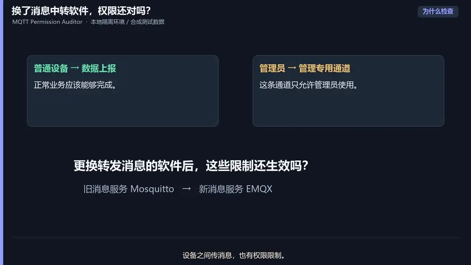
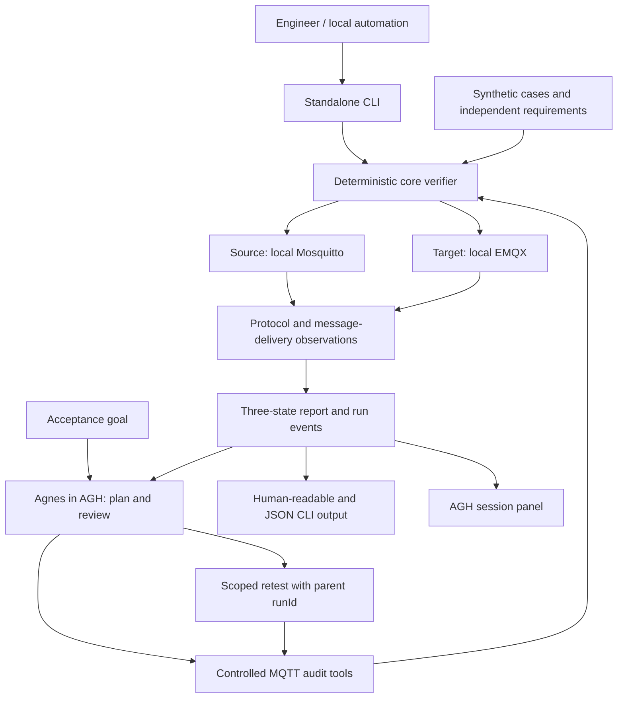

# MQTT Permission Auditor

English | [简体中文](README.zh-CN.md)

<div align="center">

### Verify MQTT permissions with observable evidence.

**Acceptance testing for Mosquitto → EMQX file ACL migrations, with a standalone verifier and an Agnes Harness workflow.**


[Project Overview](#project-overview) · [Demo Video](#demo-video) · [Architecture](#architecture) · [Integration Standards](#integration-standards) · [Quickstart](#quickstart)

</div>

<p align="center">
  <a href="docs/操作演示视频.mp4">
    
  </a>
</p>

<p align="center"><sub>29-second silent looping preview · Click to watch the full demo with audio.</sub></p>

## Project Overview

### Background

Moving an MQTT workload between platforms can change how ACL wildcards, rule order and default decisions behave. A configuration that looks equivalent may allow a forbidden operation or interrupt a required workflow. Comparing the old and new configurations alone also misses mistakes that already existed on both sides.

MQTT Permission Auditor checks a fixed **Mosquitto → EMQX file ACL migration** against independently defined business requirements. It performs synthetic publish/subscribe operations on both local Brokers and turns protocol observations into reviewable results.

### Core capabilities

- **Three separate acceptance dimensions:** permission expansion, business damage and business-requirement compliance. The old configuration is not assumed to be a correct security baseline.
- **Evidence-based verdicts:** message delivery establishes an allowed operation; an explicit topic-level subscription rejection establishes a denial. Missing evidence remains `unknown`.
- **Two execution paths:** use the zero-dependency Node.js core/CLI directly, or let Agnes plan, invoke tools and review feedback through Agnes Harness (AGH).
- **Traceable runs and retests:** correlate reports and observed events by `runId`, link retests to their parent, and label partial coverage explicitly.
- **A session-linked panel:** inspect process events, Broker health, evidence and retest comparisons in the AGH workbench.
- **Reproducible local fixtures:** eight synthetic checks (c1–c8), fixed Broker image digests, and `naive`, `corrected` and `omission` ACL variants.

### Design highlights

The project combines a deterministic verifier with an agent-guided acceptance workflow. Agnes chooses and explains actions; code and actual observations decide permissions. The panel displays those results rather than calculating a second verdict.

A key distinction is **permission observations versus requirement results**: an observed `allow` can produce a business `fail` when that operation should be forbidden. Conversely, a missing delivery does not prove a denial. This keeps uncertainty visible and prevents a migration from passing merely because both configurations make the same mistake.

The archived evidence records local Broker checks, real Agnes tool calls and panel verification separately. See the [evidence index](docs/evidence/README.md) and [progress log](docs/progress.md) for dates and limits; those records are not a fresh test of the current runtime.

## Demo Video

**[Watch or download the project demo →](docs/操作演示视频.mp4)**

The walkthrough shows the acceptance goal, actual tool execution and observable results in three situations:

| Scenario | What to look for |
| --- | --- |
| Business failure | A forbidden target-side delivery establishes a requirement failure; expansion requires separate source-side denial evidence. |
| Broker unavailable | Missing observations produce `unknown`, rather than a denial or a passing audit. |
| Successful scoped check | A delivery check passes after recovery, with its limited coverage stated explicitly. |

The demonstration uses isolated local Brokers and synthetic data. A successful c1 check does not mean the full migration passed. Recording and editing details are in the [original demo evidence](docs/evidence/demo-video-20261014.md) and [revised narration record](docs/evidence/demo-video-v2-20261015.md). If GitHub does not play the MP4 inline, open the video file and use its download control. The recorded walkthrough has Chinese narration/subtitles.

## Architecture

### One verifier, two entry points



### Core modules

| Module | Implementation and responsibility |
| --- | --- |
| [`core/`](core/README.md) | Minimal MQTT 3.1.1 client, publish/subscribe probes, health gating, deterministic verdicts, aggregation and report rendering. |
| [`cli/`](cli/README.md) | Standalone audit command and controlled Docker environment lifecycle (`init`, `up`, `check`, `audit`, `down`). |
| [`plugins/agh/`](plugins/agh/README.md) | `mqtt-audit-tools` 0.3.0: tool definitions, run store, append-only events, health monitoring and read-only panel services. Bundled core and case files are checked against the root copies. |
| [`fixtures/`](fixtures/README.md) / [`deploy/`](deploy/README.md) | Synthetic identities, topics, independent expectations, ACL variants and Broker templates. Credentials are generated locally. |
| [`tests/`](tests/README.md) | Protocol, verdict, aggregation, CLI boundary, plugin contract, bundled-file consistency and panel checks. |
| [`agh_launcher.py`](agh_launcher.py) | Windows launcher for a local AGH Web service; it does not bundle AGH, Brokers, Node.js or a model. |

### Execution and verdicts

The workflow discovers the case set, prepares a run, executes the probes, reads the structured report and explains evidence and limits. A retest retains `parentRunId` and selected check IDs; the initial run covers c1–c8, with at most two retest rounds per root task.

| Layer | Values | Meaning |
| --- | --- | --- |
| Permission observation | `allow` / `deny` / `unknown` | What the protocol and delivery evidence establish for an operation. |
| Requirement result | `pass` / `fail` / `unknown` | Whether the observation meets the independent expected permission. |
| Overall result | `fail` > `unknown` > `pass` | A known failure takes precedence over uncertainty. |

In MQTT 3.1.1, PUBACK does not contain an authorization decision. A publish without delivery, CONNACK 4/5, a timeout, a connection failure or unsupported syntax cannot establish topic-level denial. The supported explicit topic-denial evidence is subscription SUBACK `0x80`. See the [verdict implementation](core/prober.mjs) and [architecture notes](docs/architecture.md).

## Integration Standards

These are the project's implemented contracts and compatibility limits, rather than a claim of certification or compatibility with every AGH release.

### Runtime and protocol compatibility

| Area | Contract |
| --- | --- |
| Runtime | Node.js **24.10+**, ECMAScript modules; core and backend tools have no third-party npm runtime dependencies. |
| MQTT | **MQTT 3.1.1**, publish/subscribe probes with message correlation and delivery witnesses. No verified MQTT 5 verdict path. |
| Brokers | Recorded baseline: Mosquitto **2.1.2** and EMQX **6.3.1**, pinned by image digest; see [environment versions](docs/environment-versions.md). |
| Local deployment | Docker Desktop with Linux containers, or Docker Engine; Compose v2 or a compatible version. Separate source/target bridge networks and loopback-only MQTT ports. |
| AGH host | Verified against upstream commit `c4efd170547a225890664c1c186a7347399b53e0`. AGH is installed separately; this project does not upgrade it or claim compatibility with the current upstream release. |
| Plugin/UI | ESM plugin manifest in [`package.json`](plugins/agh/mqtt-audit-tools/package.json); AGH-provided React runtime; `dsh-client-slots/v1` with `rightbar`, `sidebar.panellist` and `shell.overlay`. |

### Controlled tool interface

Tools use JSON Schema-style parameter definitions through AGH's plugin API. The accepted case and instance identifiers are `migration-baseline` and `local-isolated`; unknown properties are disallowed by the declared schemas. Interfaces do not expose arbitrary Shell commands, file paths, network targets or model selection.

| Tool | Parameters | Purpose |
| --- | --- | --- |
| `mqtt_audit_list_cases` | `{}` | Discover checks and independent requirements. |
| `mqtt_audit_prepare_run` | `caseId`, optional `instanceId`, `parentRunId`, `checkIds` | Allocate a run; prepare a scoped retest when a parent is supplied. No Broker connection at this step. |
| `mqtt_audit_run_check` | `caseId`, optional `instanceId`, `runId` | Execute the prepared run; omitting `runId` starts a full run. |
| `mqtt_audit_read_result` | `runId` | Retrieve a completed structured report. |
| `mqtt_audit_plan_next` | `runId` | Optional bounded Jev advice, disabled by default; Agnes retains action selection. |

Run IDs match `^run-[A-Za-z0-9_-]{1,128}$`; scoped check IDs are c1–c8. The [tool source](plugins/agh/mqtt-audit-tools/index.mjs) and [packaged Skill](plugins/agh/mqtt-audit-tools/skills/mqtt-migration-audit.md) define the full contract and workflow.

### Reports and panel services

- Audit reports use schema **`mqtt-permission-audit/1`**, including `caseSet`, `brokers`, `checks`, `summary` and `scope`; `summary.overall` is `pass`, `fail` or `unknown`.
- AGH run reports additionally carry `runId`, `parentRunId`, `rootRunId`, `round`, `checkIds` and `coverage` so a partial retest cannot stand in for full acceptance.
- Tools return AGH `content` and `structured` payloads. Tool-layer errors use `mqtt-permission-audit-tool/1` with `status: "error"`, a code and a message; they are not ACL verdicts.
- Read-only services are `mqtt.audit.latestresult`, `mqtt.audit.runstatus`, `mqtt.audit.events` and `mqtt.audit.health`. The panel selects run IDs from the current session's tool records; independent CLI results and unrelated sessions are not automatically mixed in.

### Integration paths

**Standalone CLI / local automation.** Run the verifier directly and consume its JSON report and exit code:

```sh
node cli/run-audit.mjs --source 127.0.0.1:11883 --target 127.0.0.1:2883 --creds .local/env/creds.json --cases fixtures/cases/migration-baseline.json --json .local/env/audit-result.json
```

| Audit CLI exit code | Meaning |
| --- | --- |
| `0` | All requirements pass. |
| `1` | At least one failure was found. |
| `2` | No failure, but at least one result is unknown. |
| `3` | Argument, configuration or runtime error. |

The CLI can be called by a future CI workflow; this README does not claim a configured or verified hosted CI pipeline.

**AGH plugin.** Start the local Broker environment, then install `plugins/agh/mqtt-audit-tools` through AGH's local-source plugin workflow. Review integrity and capabilities, trust and enable the package, and start a new session with the `mqtt-migration-audit` Skill available. No separate MCP server is required.

If using a named environment, set `MQTT_AUDIT_CREDS` in the AGH process environment **before starting AGH**, pointing to that environment's synthetic `creds.json`. Otherwise the plugin checks `.local/reproducible/creds.json` before `.local/env/creds.json`. Configure the official Agnes account through AGH itself; never copy or export model credentials. Confirm the tool trace, report and panel use the same `runId`. See the [deployment guide](docs/deployment.md).

Jev is an optional fixed-provider recommendation path, not a second execution loop or a source of permission verdicts. Keep it disabled for competition use unless the rules explicitly allow it.

## Quickstart

### 1. Run unit and contract checks

```sh
git clone https://github.com/M-ui-si/mqtt-permission-auditor.git
cd mqtt-permission-auditor
node --version
npm test
```

Node.js 24.10+ is required. No `npm install`, Docker, AGH or model account is needed for this test path.

### 2. Reproduce the local Broker scenario

Start Docker in Linux container mode and check that its engine and Compose are available:

```sh
docker version
docker compose version
npm run env:init
npm run env:up
npm run env:check
npm run env:audit
npm run env:down
```

`env:init` generates random synthetic credentials in `.local/env/` and refuses to overwrite an existing directory. `env:down` stops this environment and preserves files and volumes. The first startup needs the pinned images locally or access to fetch them.

The default **`naive` audit is expected to fail with exit code 1**: c3 is delivered on the target despite a business prohibition. Source-side uncertainty still does not establish permission expansion. `corrected` may remain `unknown` because missing delivery does not prove rejection; `omission` demonstrates a missing business authorization. Use a fresh environment name to choose a variant, and stop an existing environment before reusing its fixed ports:

```sh
node cli/environment.mjs init --name demo --variant corrected
node cli/environment.mjs up --name demo
node cli/environment.mjs check --name demo
node cli/environment.mjs audit --name demo
node cli/environment.mjs down --name demo
```

### 3. Open the AGH interface (optional)

On Windows, [`MQTT权限迁移审计器.exe`](MQTT权限迁移审计器.exe) starts or reuses the local AGH Web interface. Node.js, the pinned AGH CLI build and an official Agnes account for model-driven sessions are separate prerequisites. The launcher does not include Brokers or a model. See the [runtime and launcher guide](运行说明.md) for lookup paths and rebuilding with Python/PyInstaller.

## Safety and Scope

All project cases use synthetic identities, ACLs, topics and messages. The verifier accepts only numeric loopback `127.0.0.1`; `localhost`, domains and remote Brokers are rejected. MQTT ports are bound to `127.0.0.1:11883` and `127.0.0.1:2883`; the EMQX management dashboard is not published to the host.

Keep `.local/`, credentials, raw sessions and runtime reports out of Git and public evidence. Review and redact session exports before sharing. EMQX's recorded image is BSL-1.1 and is used only for local single-node tests; this project does not redistribute it. Third-party AGH UI attribution is retained in the [source notice](plugins/agh/mqtt-audit-tools/third-party/agnes-harness/README.md).

Finite checks establish results only for the tested identities, topics, operations and versions. They do not prove full ACL equivalence, production readiness or cross-environment portability. Unit checks, real Broker integration, real Agnes sessions and browser rendering are distinct kinds of evidence.

## Documentation

[Documentation index](docs/README.md) · [Deployment](docs/deployment.md) · [Architecture notes](docs/architecture.md) · [Evidence](docs/evidence/README.md) · [Progress](docs/progress.md)

Supporting technical notes and historical evidence are primarily in Chinese. The English and Chinese READMEs cover the same four introduction sections. The presentation follows the bilingual navigation and section-based organization of [Agnes Harness](https://github.com/AgnesAI-Labs/agnes-harness).
