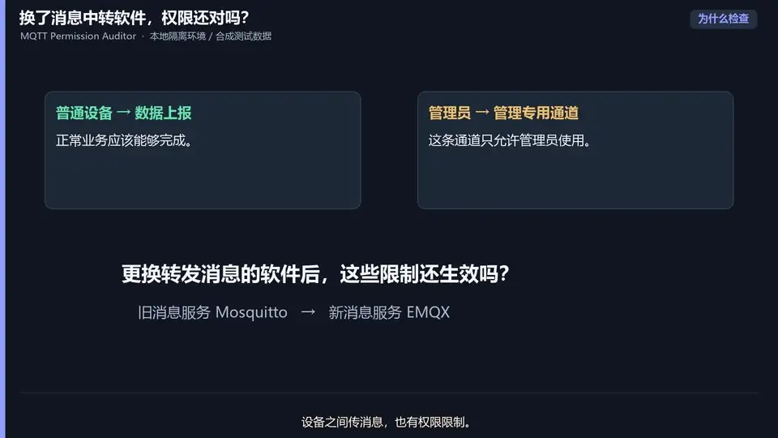
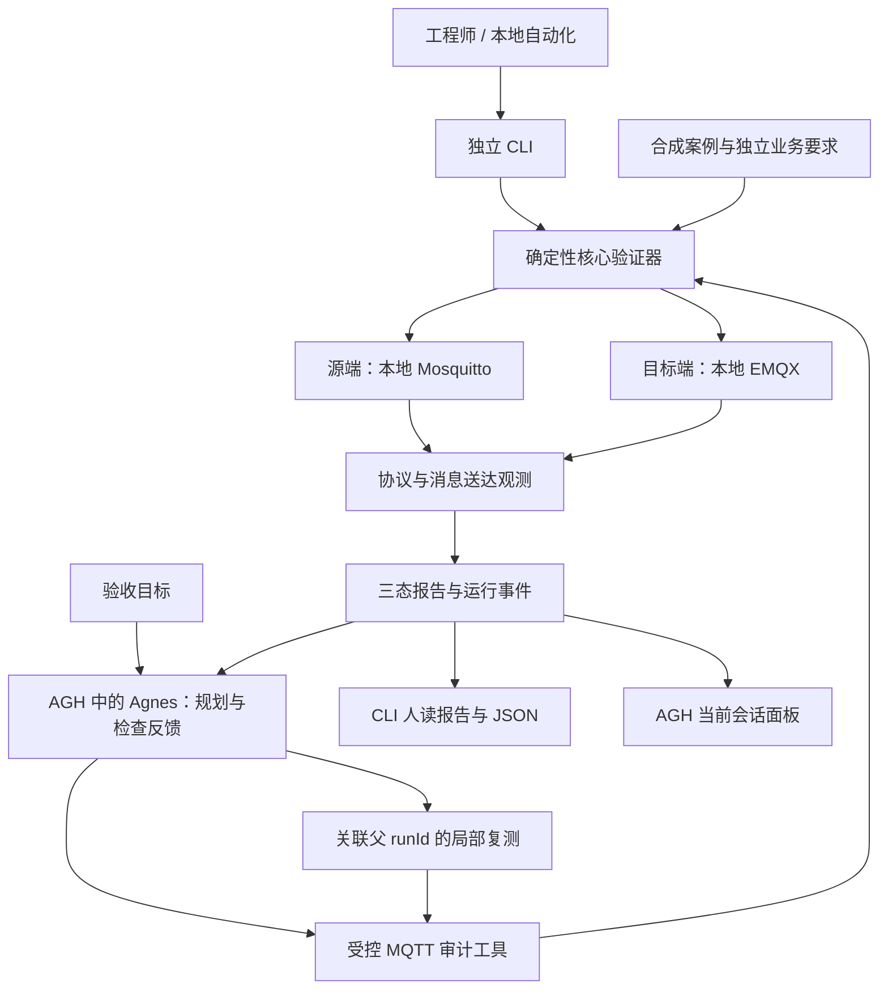

# MQTT 权限迁移审计器

[English](README.md) | 简体中文

<div align="center">

### 用可观察的证据，验收 MQTT 权限。

**面向 Mosquitto → EMQX 文件 ACL 迁移，提供独立验证器与 Agnes Harness 验收工作流。**


[项目介绍](#项目介绍) · [视频介绍](#视频介绍) · [架构介绍](#架构介绍) · [集成标准](#集成标准) · [快速开始](#快速开始)

</div>

<p align="center">
  <a href="docs/操作演示视频.mp4">
    
  </a>
</p>

<p align="center"><sub>29 秒无声循环预览 · 点击观看带声音的完整演示。</sub></p>

## 项目介绍

### 项目背景

MQTT 平台迁移时，ACL 通配符、规则顺序和默认决策的差异，可能让看似等价的配置放行禁止操作，也可能中断原有业务。只对比迁移前后的配置，还会漏掉两端本来就存在的共同错误。

本项目针对固定的 **Mosquitto → EMQX 文件 ACL 迁移**场景，以独立定义的业务要求作为验收依据，在两端本地 Broker 上执行合成发布/订阅操作，将协议观测整理为可复核的结果。

### 核心功能

- **三个维度分别验收**：权限扩大、业务受损、业务要求符合性；不把旧配置默认当作正确的安全基准。
- **依据证据判定**：实际消息送达证明操作允许，明确的主题级订阅拒绝证明拒绝；证据不足保留为 `unknown`。
- **两种执行入口**：零依赖 Node.js 核心与 CLI 可独立使用；也可由 Agnes 通过 Agnes Harness（AGH）规划、调用工具并检查反馈。
- **运行与复测可追溯**：通过 `runId` 关联报告和观测事件，复测关联父运行，并明确标注局部覆盖范围。
- **会话关联面板**：在 AGH 工作台查看过程事件、Broker 健康、证据和复测对比。
- **本地合成场景复现**：包含 c1–c8 共八项检查、固定摘要的 Broker 镜像，以及 `naive`、`corrected`、`omission` 三种 ACL 档案。

### 设计亮点

项目将确定性验证器与模型引导的验收工作流结合：Agnes 选择并解释行动，代码和实际观测决定权限结论；面板展示同一份结果，不另行计算第二套判定。

核心设计是区分**权限观测与业务验收结果**：某项操作观测为 `allow`，但业务明确要求禁止时，验收结果仍为 `fail`。反之，没有送达不能证明已经拒绝。这既保留了不确定性，也避免把“迁移前后犯了同样的错误”算作通过。

归档材料分别记录了本地 Broker 检查、真实 Agnes 工具调用和面板验收。日期与局限见[证据索引](docs/evidence/README.md)和[进度记录](docs/progress.md)；历史记录不等同于对当前运行环境的新一轮验证。

## 视频介绍

**[观看或下载项目演示视频 →](docs/操作演示视频.mp4)**

演示围绕验收目标、实际工具执行和可观察结果，展示三类情况：

| 场景 | 观看重点 |
| --- | --- |
| 业务失败 | 目标端禁止主题实际送达，可证明业务要求失败；权限扩大仍需源端明确拒绝的独立证据。 |
| Broker 不可用 | 缺失观测时输出 `unknown`，不将其视为拒绝或验收通过。 |
| 局部检查成功 | 环境恢复后送达检查通过，同时明确该结果的有限覆盖范围。 |

演示只使用本地隔离 Broker 与合成数据。c1 单项通过不代表完整迁移验收通过。录制与剪辑说明见[原始实录证据](docs/evidence/demo-video-20261014.md)和[新版配音制作记录](docs/evidence/demo-video-v2-20261015.md)。若 GitHub 未内嵌播放 MP4，可打开视频文件并使用下载入口观看。现有视频采用中文配音和中文字幕。

## 架构介绍

### 共用验证器，支持两个入口



### 核心模块

| 模块 | 实现方式与职责 |
| --- | --- |
| [`core/`](core/README.md) | 最小 MQTT 3.1.1 客户端、发布/订阅探针、健康门控、确定性判定、聚合与报告渲染。 |
| [`cli/`](cli/README.md) | 独立审计命令，以及受控 Docker 环境生命周期管理：`init`、`up`、`check`、`audit`、`down`。 |
| [`plugins/agh/`](plugins/agh/README.md) | `mqtt-audit-tools` 0.3.0：工具定义、运行存储、追加事件、健康监测与只读面板服务。内嵌核心和案例文件通过检查保持与根目录副本一致。 |
| [`fixtures/`](fixtures/README.md) / [`deploy/`](deploy/README.md) | 合成身份、主题、独立期望、ACL 档案与 Broker 模板；凭据在本地生成。 |
| [`tests/`](tests/README.md) | 协议、判定、聚合、CLI 边界、插件契约、内嵌文件一致性与面板检查。 |
| [`agh_launcher.py`](agh_launcher.py) | Windows 本地 AGH Web 启动器；不打包 AGH、Broker、Node.js 或模型。 |

### 执行流程与判定

工作流先发现案例集、准备运行，再执行探针、读取结构化报告，解释证据与局限。复测保留 `parentRunId` 和选定的检查项；首次运行覆盖 c1–c8，每个根任务最多两轮复测。

| 层次 | 取值 | 含义 |
| --- | --- | --- |
| 权限观测 | `allow` / `deny` / `unknown` | 协议与送达证据能够证明的操作权限。 |
| 业务要求结果 | `pass` / `fail` / `unknown` | 观测是否满足独立定义的预期权限。 |
| 总体结果 | `fail` > `unknown` > `pass` | 已知失败优先于不确定性。 |

MQTT 3.1.1 的 PUBACK 不包含授权决策。发布未送达、CONNACK 4/5、超时、连接失败或不支持的语法，均不能证明主题级拒绝。当前支持的明确主题拒绝证据是订阅 SUBACK `0x80`。详见[判定实现](core/prober.mjs)与[架构说明](docs/architecture.md)。

## 集成标准

本节说明项目已实现的接口约定及兼容边界，不宣称获得标准认证，也不宣称兼容所有 AGH 版本。

### 运行时与协议兼容

| 领域 | 约定 |
| --- | --- |
| 运行时 | Node.js **24.10+**，ECMAScript Modules；核心与后端工具没有第三方 npm 运行依赖。 |
| MQTT | **MQTT 3.1.1** 发布/订阅探针，使用消息关联标识与送达见证；尚无经过验证的 MQTT 5 判定路径。 |
| Broker | 已归档基线为 Mosquitto **2.1.2**、EMQX **6.3.1**，按镜像摘要固定，见[环境版本](docs/environment-versions.md)。 |
| 本地部署 | Docker Desktop（Linux 容器）或 Docker Engine，Compose v2 或兼容版本；源端/目标端使用独立 bridge 网络，MQTT 端口只绑定回环地址。 |
| AGH 宿主 | 已验证上游提交 `c4efd170547a225890664c1c186a7347399b53e0`；AGH 需独立安装，本项目不升级宿主，也不据此宣称兼容当前上游版本。 |
| 插件与界面 | 通过 [`package.json`](plugins/agh/mqtt-audit-tools/package.json) 声明 ESM 插件，使用 AGH 提供的 React 运行时；槽位协议为 `dsh-client-slots/v1`，注册 `rightbar`、`sidebar.panellist`、`shell.overlay`。 |

### 受控工具接口

工具通过 AGH 插件 API 使用 JSON Schema 风格的参数定义。合法案例和实例标识分别为 `migration-baseline`、`local-isolated`；声明的参数 schema 禁止额外字段。接口不开放任意 Shell、文件路径、网络目标或模型选择。

| 工具 | 参数 | 用途 |
| --- | --- | --- |
| `mqtt_audit_list_cases` | `{}` | 查询检查项及独立业务要求。 |
| `mqtt_audit_prepare_run` | `caseId`，可选 `instanceId`、`parentRunId`、`checkIds` | 分配运行；提供父运行时准备局部复测。此步不连接 Broker。 |
| `mqtt_audit_run_check` | `caseId`，可选 `instanceId`、`runId` | 执行已准备的运行；省略 `runId` 时新建全量运行。 |
| `mqtt_audit_read_result` | `runId` | 读取已完成的结构化报告。 |
| `mqtt_audit_plan_next` | `runId` | 可选的有限 Jev 建议，默认关闭；Agnes 保留行动选择权。 |

运行标识匹配 `^run-[A-Za-z0-9_-]{1,128}$`，局部检查项限 c1–c8。完整契约与工作流见[工具源码](plugins/agh/mqtt-audit-tools/index.mjs)和[包内 Skill](plugins/agh/mqtt-audit-tools/skills/mqtt-migration-audit.md)。

### 报告与面板服务

- 审计报告使用 **`mqtt-permission-audit/1`** schema，包含 `caseSet`、`brokers`、`checks`、`summary`、`scope`；`summary.overall` 为 `pass`、`fail` 或 `unknown`。
- AGH 运行报告额外包含 `runId`、`parentRunId`、`rootRunId`、`round`、`checkIds`、`coverage`，避免将局部复测当作全量验收。
- 工具返回 AGH 的 `content` 与 `structured`。工具层错误使用 `mqtt-permission-audit-tool/1`，携带 `status: "error"`、错误码和说明；它不属于 ACL 判定。
- 只读服务包括 `mqtt.audit.latestresult`、`mqtt.audit.runstatus`、`mqtt.audit.events`、`mqtt.audit.health`。面板从当前会话的工具记录选择运行标识，不自动混入独立 CLI 结果或其他会话。

### 集成方式

**独立 CLI / 本地自动化。** 直接执行验证器，通过 JSON 报告与退出码接收结果：

```sh
node cli/run-audit.mjs --source 127.0.0.1:11883 --target 127.0.0.1:2883 --creds .local/env/creds.json --cases fixtures/cases/migration-baseline.json --json .local/env/audit-result.json
```

| 审计 CLI 退出码 | 含义 |
| --- | --- |
| `0` | 全部业务要求通过。 |
| `1` | 至少发现一项失败。 |
| `2` | 没有已知失败，但至少一项无法判定。 |
| `3` | 参数、配置或运行错误。 |

CLI 可供后续 CI 工作流调用；本说明不表示已经配置或验收了托管 CI 流水线。

**AGH 插件。** 先启动本地 Broker 环境，再通过 AGH 的本地来源插件流程安装 `plugins/agh/mqtt-audit-tools`。核对完整性摘要与能力，授信、启用，并在新会话中确认 `mqtt-migration-audit` Skill 可用；无需另装 MCP 服务器。

使用具名环境时，应在**启动 AGH 之前**，将 AGH 进程环境中的 `MQTT_AUDIT_CREDS` 指向该环境合成 `creds.json` 的绝对路径。未设置时，插件先检查 `.local/reproducible/creds.json`，再检查 `.local/env/creds.json`。官方 Agnes 账户通过 AGH 自身配置，不复制或导出模型凭据。核对工具轨迹、报告和面板使用同一 `runId`。详见[部署指南](docs/deployment.md)。

Jev 仅提供固定供应商的可选建议，不形成第二个执行闭环，也不决定权限结论。比赛规则明确允许前保持关闭。

## 快速开始

### 1. 执行单元与契约检查

```sh
git clone https://github.com/M-ui-si/mqtt-permission-auditor.git
cd mqtt-permission-auditor
node --version
npm test
```

需要 Node.js 24.10+。此测试入口无需执行 `npm install`，也不需要 Docker、AGH 或模型账户。

### 2. 复现本地 Broker 场景

将 Docker 启动为 Linux 容器模式，确认 Engine 与 Compose 可用后执行：

```sh
docker version
docker compose version
npm run env:init
npm run env:up
npm run env:check
npm run env:audit
npm run env:down
```

`env:init` 在 `.local/env/` 生成随机合成凭据，拒绝覆盖现有目录。`env:down` 停止本环境并保留文件及数据卷。首次启动需要本地已有固定镜像，或能够拉取镜像。

默认 **`naive` 档案预期审计失败，退出码为 1**：c3 在业务禁止的情况下仍于目标端送达。源端无法判定时仍不能证明权限扩大。`corrected` 可能继续为 `unknown`，因为未送达不能证明拒绝；`omission` 用于展示业务授权遗漏。选择档案需新建具名环境，并先停止占用固定端口的现有环境：

```sh
node cli/environment.mjs init --name demo --variant corrected
node cli/environment.mjs up --name demo
node cli/environment.mjs check --name demo
node cli/environment.mjs audit --name demo
node cli/environment.mjs down --name demo
```

### 3. 打开 AGH 界面（可选）

Windows 用户可通过 [`MQTT权限迁移审计器.exe`](MQTT权限迁移审计器.exe) 启动或复用本地 AGH Web 界面。Node.js、固定版本的 AGH CLI 构建产物，以及执行模型会话所需的官方 Agnes 账户，均需另行准备。启动器不包含 Broker 或模型。查找路径及 Python/PyInstaller 重建方式见[运行与启动器说明](运行说明.md)。

## 安全边界与范围

全部案例仅使用合成身份、ACL、主题和消息。验证器只接受数字回环地址 `127.0.0.1`，拒绝 `localhost`、域名及远程 Broker。MQTT 端口绑定 `127.0.0.1:11883` 和 `127.0.0.1:2883`；EMQX 管理后台不发布到宿主机。

不要将 `.local/`、凭据、原始会话和运行报告提交到 Git 或公开证据中；会话导出需先检查并脱敏。已记录的 EMQX 镜像采用 BSL-1.1，仅用于本地单节点测试，本项目不重新分发镜像。AGH 第三方界面代码的来源及归属保留在[来源说明](plugins/agh/mqtt-audit-tools/third-party/agnes-harness/README.md)中。

有限检查只证明已测身份、主题、操作和版本下的结果，不证明全空间 ACL 等价、生产可用性或跨环境可移植性。单元检查、真实 Broker 集成、真实 Agnes 会话与浏览器渲染属于不同层次的证据。

## 文档导航

[文档索引](docs/README.md) · [部署指南](docs/deployment.md) · [架构说明](docs/architecture.md) · [证据记录](docs/evidence/README.md) · [进度与交接](docs/progress.md)

配套技术说明和历史证据主要为中文。中英文 README 对应覆盖相同的四项介绍。本页参考 [Agnes Harness](https://github.com/AgnesAI-Labs/agnes-harness) 的双语导航与分章节组织方式。
